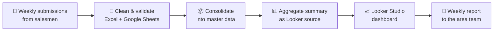

# 📊 Visibility Monitoring Dashboard

<p>
  <a href="https://datastudio.google.com/reporting/aae23ffa-5def-498b-84ff-52e835c3e9b3"></a>
  <a href="#-data"></a>
  
  
</p>

> ### ⚠️ Disclaimer: Synthetic Data Only
>
> **The dashboard shown in this repository uses synthetic (dummy) data only.**
> All regions, sites, salesmen, channels, and numbers are fictional.
> This is a portfolio replica. It contains **no real company data, no real
> outlet or salesman names, no real photos, and no real totals.**
> The company logo and product photos are **not** included in this repository
> or in the dashboard screenshots below.
> Published with permission from my internship mentor to publish the replica
> with dummy data.

## Contents

1. [What this project is](#-what-this-project-is)
2. [Live demo](#-live-demo)
3. [Dashboard preview](#-dashboard-preview)
4. [Key results](#-key-results)
5. [How the dashboard works](#-how-the-dashboard-works)
6. [Data](#-data)
7. [How it was built](#-how-it-was-built)
8. [My role](#-my-role)
9. [How to reproduce it](#-how-to-reproduce-it)
10. [Known limitations](#-known-limitations)

## 📌 What this project is

During my internship as a Sales Digital Business Application Intern at
PT Amerta Indah Otsuka, I worked on **National General Trade Visibility
Monitoring**. Every week, salesmen submitted photos of product displays
from outlets across regions, branches, sites, and salesmen.

The area team needed one clear answer each week:

> **How many displays were actually available and correctly shown, and where
> should we follow up first?**

Before this dashboard, visibility data arrived as thousands of separate
weekly submissions, with inconsistent dates, missing rows, and duplicate
entries. The raw sheet had tens of thousands of rows, which made Looker
Studio slow and hard to maintain.

This repository is a portfolio replica of that work. It shows the dashboard
structure, the calculation logic, and the cleaning and validation process,
using synthetic data only.

## 🚀 Live demo

| Page | Link |
|---|---|
| **Branch** — Visibility Monitoring | [Open Branch page](https://datastudio.google.com/reporting/aae23ffa-5def-498b-84ff-52e835c3e9b3/page/p_06m34aca8d) |
| **Region** — Visibility Monitoring 2026 | [Open Region page](https://datastudio.google.com/reporting/aae23ffa-5def-498b-84ff-52e835c3e9b3/page/p_m6ixlpw97d) |

Both pages are in one Looker Studio report. They share the same layout and
logic, and differ only in coverage:

| | Branch | Region |
|---|---|---|
| Coverage | Per site and salesman | Aggregated per region |
| Sites | 8 fictional sites | 12 fictional sites |
| Salesmen | 6 fictional salesmen | 8 fictional salesmen |
| Regions | — | 3 fictional regions |

## 🖼️ Dashboard preview

### Branch — Visibility Monitoring


### Region — Visibility Monitoring


> **About these screenshots:** updated 21 November 2026, 15:59 WIB, from the
> cleaned dashboard. The header was cropped out on purpose, so the images
> contain no company logo or product photo. The live Looker copy still shows
> the logo and product photos in its header, so do not use a screenshot that
> still shows them. The right edge is still truncated in these images,
> because the browser tool only saves pages as portrait PDF. For a final
> full-width screenshot, capture the page directly in landscape in your
> own browser. The numbers in the screenshots are synthetic data only.

## 📈 Key results

> All numbers below are **synthetic data only**, verified in the Looker Studio
> replica on 21 November 2026. They are demo numbers, not company results.

### Branch

| KPI | Value |
|---|---:|
| Total Submission | **7,837** |
| Visibility Rate | **66.19%** |
| Available | **5,187** |
| No Display | 832 |
| No Photo | 511 |
| Photo Issue | 1,307 |

- **Period:** 1 January – 7 November 2026, Week 1–41
- **Category mix:** Available 66.2%, No Display 10.6%, Photo Issue 16.7%, No Photo 6.5%
- **Last 3 weeks:** Week 39, 63.69% / 107 · Week 40, 77.30% / 109 · Week 41, 57.18% / 474
- **Non-available mix:** Photo Issue 49.3% · No Display 31.4% · No Photo 19.3%

**Site ranking, lowest to highest Visibility Rate:**

| Rank | Site | Visibility Rate |
|---:|---|---:|
| 1 | Site 002 | 59% |
| 2 | Site 001 | 64% |
| 3 | Site 004 | 64% |
| 4 | Site 003 | 65% |
| 5 | Site 007 | 68% |
| 6 | Site 005 | 69% |
| 7 | Site 008 | 71% |
| 8 | Site 006 | 71% |

### Region

| KPI | Value |
|---|---:|
| Total Submission | **9,639** |
| Visibility Rate | **60.37%** |
| Available | **5,819** |
| No Display | 917 |
| No Photo | 691 |
| Photo Issue | 2,212 |

- **Period:** 1 January – 7 November 2026, Week 1–41
- **Category mix:** Available 60.4%, No Display 9.5%, Photo Issue 22.9%, No Photo 7.2%
- **Last 3 weeks:** Week 39, 50.85% / 119 · Week 40, 60.31% / 79 · Week 41, 58.76% / 550
- **Non-available mix:** Photo Issue 57.9% · No Display 24.0% · No Photo 18.1%

**Site ranking, lowest to highest Visibility Rate:**

| Rank | Site | Visibility Rate |
|---:|---|---:|
| 1 | Site 006 | 46% |
| 2 | Site 003 | 54% |
| 3 | Site 007 | 57% |
| 4 | Site 012 | 58% |
| 5 | Site 002 | 59% |
| 6 | Site 010 | 62% |
| 7 | Site 011 | 63% |
| 8 | Site 004 | 63% |
| 9 | Site 001 | 63% |
| 10 | Site 005 | 64% |
| 11 | Site 008 | 65% |
| 12 | Site 009 | 73% |

## ⚙️ How the dashboard works

### Filters

| Filter | Branch options | Region options |
|---|---|---|
| Year | ALL, 2026 | ALL, 2026 |
| Month | ALL, January–November | ALL, January–November |
| Region Name | Site 001–008 | Region A, Region B, Region C |
| Branch / Site Name | Site 001–008 | Site 001–012 |
| Focus Location | MAIN ROAD, SCHOOL, SPORT, TOURISM, PUBLIC TRANSPORT | MAIN ROAD, SCHOOL, SPORT, TOURISM, PUBLIC TRANSPORT |
| Salesman Code | Salesman 01–06 | Salesman 01–08 |

### Charts

| # | Chart | Type | Dimension | Metric |
|---:|---|---|---|---|
| 1 | Monthly Visibility Trend by Available | Combo bar + line | `ACTIVITY_DATE` | Visibility Rate + Available |
| 2 | Last 3 Weeks Trend by Available | Combo bar + line | `WEEK` | Visibility Rate + Available |
| 3 | Non-Available Status Distribution | Donut | `CATEGORY_GROUP` | Total Submission |
| 4 | Non-Available by Focus Location | Horizontal stacked bar | `CHANNEL` | Available, No Display, No Photo, Photo Issue |
| 5 | Table by Site | Table | `SITE` | Available + Visibility Rate |
| 6 | Table by Salesman | Table | `SALESMAN` + `SITE` | Visibility Rate |

Branch has 48 salesman-site rows, Region has 96.

### Key calculation

```text
Visibility Rate = SUM(AVAILABLE) / SUM(TOTAL_SUBMISSION)
```

- Branch field in Looker: `VISIBILITY RATE`
- Region field in Looker: `VISIBILITY_RATE`
- Type: Percent. Create it as a calculated field in Looker Studio,
  **not** as a column in the sheet.
- `MONTH_ORDER` is also a calculated field in Looker, so months sort
  correctly. Never sort by the text field `MONTH` itself.

## 🗂️ Data

### Files in this repository

| File | Rows | Grain |
|---|---|---|
| `data/dummy-visibility-branch-summary.csv` | 1,200 | One row per YEAR / MONTH / WEEK / SITE / SALESMAN / CHANNEL / CATEGORY_GROUP / ACTIVITY_DATE |
| `data/dummy-visibility-region-summary.csv` | 1,500 | One row per YEAR / MONTH / WEEK / REGION / SITE / SALESMAN / CHANNEL / CATEGORY_GROUP / ACTIVITY_DATE |
| `data/dummy-visibility-branch-collab-sample.csv` | 200 | Raw, one row per submission (Branch) |
| `data/dummy-visibility-region-collab-sample.csv` | 200 | Raw, one row per submission (Region) |

The dashboard reads the two summary files, not the COLLAB samples.
The COLLAB samples show the ETL story: raw submission to aggregated summary.

### Branch summary schema — 13 columns, exact order

```text
YEAR | MONTH | WEEK | SITE | SALESMAN | CHANNEL | CATEGORY_GROUP |
ACTIVITY_DATE | TOTAL_SUBMISSION | AVAILABLE | NO_DISPLAY | PHOTO_ISSUE | NO_PHOTO
```

### Region summary schema — 14 columns, exact order

```text
YEAR | MONTH | WEEK | REGION | SITE | SALESMAN | CHANNEL | CATEGORY_GROUP |
ACTIVITY_DATE | TOTAL_SUBMISSION | AVAILABLE | NO_DISPLAY | PHOTO_ISSUE | NO_PHOTO
```

The only schema difference is the `REGION` column.

### Category mapping

| DISPLAY CATEGORY | Monitoring code | CATEGORY_GROUP |
|---|---|---|
| AVAILABLE | G | Available |
| NO_DISPLAY | N | No Display |
| FOTO TIDAK SESUAI | F | Photo Issue |
| FOTO PRODUK LAIN | FTP | Photo Issue |
| NO_PHOTO | NP | No Photo |

Channels: `MAIN ROAD`, `SCHOOL`, `SPORT`, `TOURISM`, `PUBLIC TRANSPORT`.

Photo columns (`PHOTO_BEFORE`, `PHOTO_AFTER`, `LINK PHOTO`) contain only
the text `placeholder` in the COLLAB samples. No real photo is included.

### How the synthetic data was generated

1. One summary row per `CATEGORY_GROUP`. In that row, the count column
   matching the group equals `TOTAL_SUBMISSION`, and the other three count
   columns are 0. This keeps every SUM, scorecard, donut, and stacked bar correct.
2. `TOTAL_SUBMISSION` per row: random integer 1–12.
3. `ACTIVITY_DATE`: random date 1 January – 7 November 2026.
   `MONTH` and `WEEK` are derived from that date, Week 1–41.
4. Branch target mix: Available 65%, Photo Issue 18%, No Display 10%,
   No Photo 7%. Actual: 66.2% / 16.7% / 10.6% / 6.5%.
5. Region target mix: Available 58%, Photo Issue 25%, No Display 10%,
   No Photo 7%. Actual: 60.4% / 22.9% / 9.5% / 7.2%.

### Validation checks — all passed, 11 November 2026

- [x] `AVAILABLE + NO_DISPLAY + PHOTO_ISSUE + NO_PHOTO = TOTAL_SUBMISSION` in every row
- [x] No blank or unmapped category codes
- [x] No missing or invalid dates
- [x] `MONTH` matches `ACTIVITY_DATE` in every row
- [x] No negative counts

## 🔄 How it was built



1. **Collect** weekly submissions from salesmen (photo plus display category).
2. **Clean** in Excel with Power Query and in Google Sheets: fix dates,
   remove blank rows, standardise categories.
3. **Validate:** check row counts per week, check for missing activity dates,
   check for duplicate submissions, compare summary totals with raw totals.
4. **Consolidate** into master data, then build an aggregated summary as the
   single Looker Studio source. An aggregated summary loads faster than
   tens of thousands of raw rows.
5. **Publish** the Looker Studio dashboard and send the weekly report
   to the area team.

## 👤 My role

I worked on the data pipeline and the dashboard structure, with guidance
from my mentor Mas Elfin Asyari, during my internship at PT Amerta Indah Otsuka.

What I did myself: extraction and cleaning in Excel and Google Sheets,
validation checks, consolidation into master data, building the Region and
Branch summary queries, and preparing the weekly and monthly reports.
Dashboard design decisions and validation rules were discussed with my
mentor and the sales team.

## 🛠️ Tools

I have experience using Excel (including Power Query), Google Sheets, MySQL,
Python, Google Colab, Looker Studio, Power BI, and Tableau.

## 🔁 How to reproduce it

1. Upload the two summary CSVs in `data/` to Google Sheets, one spreadsheet
   per file, first row as headers. Add a README tab with the label
   "Synthetic data for portfolio demo, not company data."
2. In Looker Studio, add each sheet as a new data source. Use Sheet1.
3. Swap each chart to the matching dummy source, one chart at a time.
   Branch charts use the Branch summary, Region charts use the Region summary.
4. Create the calculated fields in Looker, not as sheet columns:
   `VISIBILITY RATE` (Branch) / `VISIBILITY_RATE` (Region) =
   `SUM(AVAILABLE) / SUM(TOTAL_SUBMISSION)`, type Percent.
5. Only after every chart shows dummy numbers, remove the original data
   sources from the copy. Verify the original report is unchanged and the
   copy shows only fictional names and dummy numbers.
6. Remove the company logo and any product photos from the header before
   publishing. Replace them with plain text or generic icons.
   Generic icons in the dashboard (Material Symbols Outlined) are safe to keep,
   for example Available uses `check_circle`, No Display uses `visibility_off`,
   Photo Issue uses `image_not_supported`, No Photo uses `no_photography`.

## ⚠️ Known limitations

- The Region monthly trend chart is now readable after the cleanup on
  21 November 2026: monthly Available values 506, 495, 599, 620, 612, 540,
  639, 643, 536, 495, 134, with Visibility Rates 53.43% to 66.29%.
  The month names on the X axis are still shown only as "...", not readable.
  The Branch monthly trend has the same X-axis label issue.
  Turn data labels off, or show them only on hover, if the overlap returns.
- The live Looker copy still shows the company logo and product photos in
  the header on both pages. The screenshots in this README were cropped to
  remove the header. Remove the logo and photos from the Looker copy before
  publishing any uncropped screenshot.
- Two filter labels are still not clean on the Branch page, checked
  21 November 2026, 15:58 WIB: Region Name shows "SITE" instead of ALL,
  and Focus Location shows "FOCUS LOCATION" instead of ALL.
- The dashboard formulas in this README are inferences from the displayed
  values, because the exact formulas in the original dashboard editor were
  not visible.
- Mentioning the employer by name in text, for example
  "Sales Digital Business Application Intern, PT Amerta Indah Otsuka",
  is normal employment context and is kept in this README. The company logo
  and product images are not included.

## 💡 What I learned

- An aggregated summary is often better than a raw dump for a dashboard
  that people open daily.
- Validation matters more than visualisation: a small copy error can move
  a region total, and the team will notice.
- A dashboard is only finished when the area team can read it without
  asking what a number means.

## 📁 Repository structure

```text
visibility-monitoring-dashboard/
├── README.md
├── data/
│   ├── dummy-visibility-branch-summary.csv
│   ├── dummy-visibility-region-summary.csv
│   ├── dummy-visibility-branch-collab-sample.csv
│   └── dummy-visibility-region-collab-sample.csv
└── docs/
    └── screenshots/
        ├── branch-visibility-monitoring.png
        └── region-visibility-monitoring.png
```

---

*This repository is a portfolio replica with synthetic data only. It is not
affiliated with, endorsed by, or sponsored by the company named in the
employment context above.*
